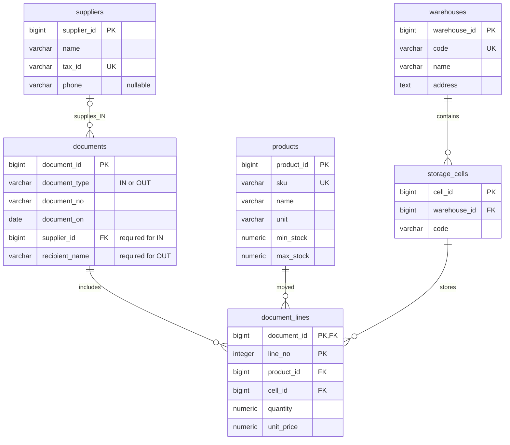

# ER-диаграмма: система управления складом

Модель содержит шесть таблиц.
`PK` — первичный ключ, `FK` — внешний, `UK` — одиночный уникальный ключ;
`||` означает ровно одну запись, `o{` — от нуля до многих, `o|` — ноль или одну.

Составные ограничения:

- `PRIMARY KEY (document_id, line_no)` — строка уникальна в документе.
- `UNIQUE (warehouse_id, code)` — код ячейки уникален внутри склада.
- `UNIQUE (document_type, document_no)` — номер уникален в пределах типа документа.

Для `IN` обязателен `supplier_id`, а `recipient_name` равен NULL;
для `OUT` обязателен непустой `recipient_name`, а `supplier_id` равен NULL.
Эти условия задаёт `CHECK` реквизитов.
Остальные атрибуты обязательны, кроме `suppliers.phone`.
Цена строки — закупочная для IN и отпускная для OUT.

`stock_balances` — вычисляемое представление, в число шести таблиц не входит;
оно содержит товар, ячейку и разность сумм поступлений и отгрузок.
